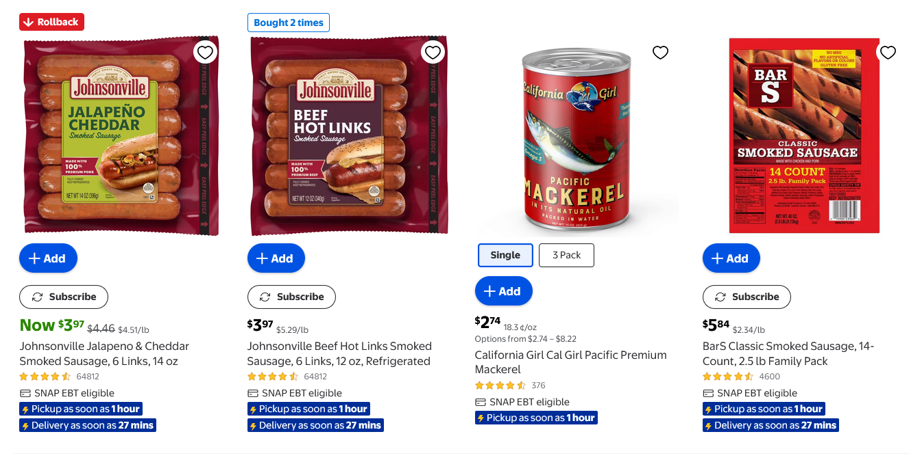
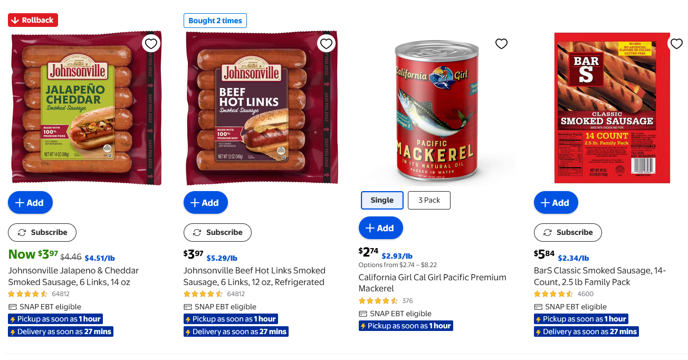

# Consistent Unit Price

Consistent Unit Price is a Chrome and Firefox extension that standardizes weight-based prices for faster, apples-to-apples shopping comparisons. It finds unit-price labels such as `$3.98/lb`, `90.7¢ per lb`, or `€2,40/kg` and displays them in one consistent format selected by the user.

## Before and after

Shopping pages often mix formats such as dollars per pound and cents per ounce. Consistent Unit Price converts those values into the selected format and gives every comparable unit price the same enlarged blue styling—even when a value did not need conversion.

| Before | After |
| :---: | :---: |
|  |  |

## What it does

- Normalizes prices into a preferred weight unit, including per ounce, per pound, per 100 grams, and per kilogram.
- Supports major and minor currency denominations where their relationship is known.
- Offers an automatic mode that uses the most common supported unit-price format on the current page.
- Can overlay the retailer's original unit price or add a separate converted label.
- Gives converted and already-matching unit prices the same prominent styling for quick visual comparison.
- Updates converted prices as supported pages load or change dynamically.
- Leaves uncertain or unsupported prices unchanged instead of guessing.

For example, a page that mixes `90.7¢/lb` and `$1.77/lb` can display both as local major currency per pound. A label such as `€2,40/kg` can be shown as `€0,24/100 g` without changing currencies.

## Store support

Amazon.com and Walmart.com use dedicated readers designed around their product pages, search results, variants, and dynamically loaded listings.

Generic shopping-site support is the next planned expansion. Users will be able to grant access to an individual store, after which the extension will look for explicit visible expressions containing:

1. A currency symbol or currency code.
2. A positive price.
3. `/`, `per`, or a supported localized equivalent.
4. A supported weight unit.

The extension does not need to identify the store or product when the unit-price expression itself is unambiguous.

## Local currencies

The extension preserves the currency used by each page. It converts the monetary denomination only when the relationship between major and minor units is known, and it never performs foreign-exchange conversion.

Localized decimal formatting is preserved when it can be interpreted safely. Ambiguous numbers, unknown denomination relationships, ranges, mixed currencies, and malformed unit prices are skipped.

## Safety boundaries

Consistent Unit Price handles prices based on product weight. It does not convert:

- Fluid ounces or other volume measurements.
- Per-item or package-count prices.
- Currency exchange rates.
- Product prices without an explicit weight denominator.
- Values whose currency, number, or unit cannot be interpreted reliably.

The extension changes only its presentation of supported unit-price labels. It does not rewrite product prices, checkout totals, package quantities, or currency identity.

## Privacy and permissions

Settings and enabled-site permissions are stored locally in the browser. The extension does not use a server, analytics service, account system, or AI service, and it does not transmit scanned page text or browsing history.

Amazon and Walmart have dedicated site controls. Generic stores will use optional per-site access by default, with an advanced all-sites option for users who explicitly choose it.

Console logging is limited to successful Walmart conversion events and does not transmit data outside the browser.

## Project status

The shared conversion engine, popup controls, Amazon integration, and Walmart integration are implemented in buildable Chrome and Firefox packages. Walmart search and category-page overlays have been verified live in Chrome. Generic international shopping-site support has an approved design and implementation plan but is not yet implemented.

See the following documents for detailed behavior and development scope:

- [Original implementation plan](docs/PLAN.md)
- [Generic shopping-site design](docs/superpowers/specs/2026-09-23-generic-shopping-sites-design.md)
- [Generic shopping-site implementation plan](docs/superpowers/plans/2026-09-23-generic-shopping-sites.md)
